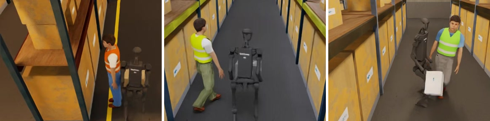

<div align="center">

# AI 휴머노이드 HRI 안전성 데이터셋 — 코드와 규격

**데이터셋을 생성 · 판정 · 변환 · 검증하는 파이프라인과 그것이 따르는 규격**

[](README.md)
[](README.ko.md)

[](https://huggingface.co/datasets/KETI-IRRC/keti-humanoid-hri-safety)
[](docs/tech-report/humanoid-dataset-technical-report-v0.1.pdf)
[](LICENSE)
[](LICENSE-DATASET)



*`S1e` 랙에 가린 코너 · `S1f` 옆에서 들어서는 사람 · `S1g` 상자를 든 채 돌아서기*

</div>

## 개요

[AI 휴머노이드 HRI 안전성 데이터셋](https://huggingface.co/datasets/KETI-IRRC/keti-humanoid-hri-safety)을 만든 코드와
규격 문서입니다. NVIDIA Isaac Sim · Isaac Lab 용 창고 장면과 시나리오, 기록기와 라벨러, LeRobotDataset v3.0 변환기,
검증기, 그리고 이것들이 따르는 문서가 있습니다. 데이터는 Hugging Face Hub 에 있습니다.

이 데이터셋은 **실패 · 근접사고 · 경계 사례**를 기록합니다. 상자를 든 Unitree H1 이 사람을 제때 보지 못하는 곳에서
사람과 만나며, 기록된 로봇은 사람에 반응하지 않습니다. 라벨은 **사람이 붙이지 않고 계산합니다.** 판정 규칙이 인체
12개 부위의 접촉력을 ISO/TS 15066 부속서 A 의 한계와, 사람과의 거리를 로봇의 보호 이격거리와 비교합니다. 라벨마다
그 라벨을 낸 규칙과 근거 조항이 붙습니다.

| | |
|---|---|
| 데이터셋 | [`KETI-IRRC/keti-humanoid-hri-safety`](https://huggingface.co/datasets/KETI-IRRC/keti-humanoid-hri-safety) — 버전 `26.11`, 태그 `v26.11.1` |
| 에피소드 | **297건** — 시나리오 3종(`S1e` · `S1f` · `S1g`), 카메라 7대 |
| 로봇 | Unitree H1 (19 DOF) |
| 시뮬레이터 | NVIDIA Isaac Sim · Isaac Lab — 버전은 [`environment.lock`](environment.lock) 에 고정 |
| 형식 | LeRobotDataset v3.0 + `safety.*` 확장 (스키마 `0.2`) |
| 근거 표준 | ISO/IEC Guide 51 · ISO 12100 · ISO 10218-1 · ISO/TS 15066 · ISO/CD 25785-1 · ISO/IEC TS 22440-1 |
| 코드 태그 | 이 저장소의 `v26.11.*` 태그는 모두 버전 26.11 을 생성한 코드를 담습니다. 뒤의 태그는 문서와 조립 · 게시 코드를 고친 것입니다 |

## 바로 해 보기

```bash
make venv     # 클론 후 1회 — .venv 를 만들고 requirements.txt 를 설치합니다
make check    # 검증기 자체 회귀 시험 + 단위 시험
```

`.venv` 가 있으면 `make` 가 활성화 없이 그 인터프리터를 씁니다. 데이터셋은 Hub 의 `hf` 명령으로 받습니다
(`huggingface_hub` 에 들어 있으며 `requirements.txt` 는 설치하지 않습니다).

```bash
hf download KETI-IRRC/keti-humanoid-hri-safety --repo-type dataset \
    --revision v26.11.1 --local-dir <release>
```

그다음은 이 저장소만으로 됩니다 — Isaac Sim 도 네트워크도 쓰지 않습니다.

```bash
# 검사 C1~C8 (C9 는 Isaac Sim 이 필요)
.venv/bin/python validator/validate_dataset.py <release>
# 배포본만으로 라벨을 모두 다시 유도
.venv/bin/python generation/labeling/check_release_labels.py --dataset <release>
# 시나리오별 점수표
.venv/bin/python generation/scorecard.py --dataset <release>
# lerobot-train 이 받는 사본
.venv/bin/python scripts/make_train_copy.py <release> <new_dir>
```

검사 항목과 종료 코드는 [`validator/README.md`](validator/README.md) 에 있습니다. 학습용 사본은 배포본을 그대로 두고
영상은 하드링크로 겁니다. 무엇을 바꾸는지는 도구의 머리말과 데이터셋 상세 문서의 「LeRobot 의 도구」에 있습니다.
LeRobot 으로 여는 법은 [데이터셋 상세 문서](docs/dataset-reference.ko.md)에, 에피소드를 다시 생성하는 법(Isaac Sim
필요)은 [`generation/README.md`](generation/README.md) 에 있습니다.

## 이 저장소에 있는 것

| 자리 | 내용 |
|---|---|
| [`docs/schema/`](docs/schema/) | 데이터 스키마 정의서 — 필드, 관절 규격, 판정 규칙, 검증 규칙, 버전 정책 |
| [`docs/scenarios/`](docs/scenarios/) | 시나리오 카탈로그 — 시나리오, 랜덤화, 에피소드 배분 |
| [`docs/assets/`](docs/assets/) | 자산 라이선스 인벤토리와 배포 방침 |
| [`docs/sop/`](docs/sop/) | 데이터 전주기 표준작업절차 — 단계별 통과 기준과 금지 사항 |
| [`docs/tech-report/`](docs/tech-report/) | 기술문서 (CC BY 4.0) — 데이터셋의 구성 · 판정 · 검증 · 활용. 읽는 판은 같은 자리의 PDF |
| [`docs/dataset-card.md`](docs/dataset-card.md) · [`docs/dataset-card.ko.md`](docs/dataset-card.ko.md) | 데이터셋 카드의 원본 — 배포본의 첫 화면 `README.md` · `README.ko.md` 가 됩니다. 링크와 그림은 배포본의 자리를 기준으로 적혀 있어 [Hub 의 데이터셋 화면](https://huggingface.co/datasets/KETI-IRRC/keti-humanoid-hri-safety)에서 열립니다 |
| [`docs/dataset-reference.md`](docs/dataset-reference.md) · [`docs/dataset-reference.ko.md`](docs/dataset-reference.ko.md) | 데이터셋 상세 문서 (영문 · 국문) — 모든 열, 조건표, 라벨 산출, 점수표와 실패 지도, 한계. 배포본에 같은 경로로 실립니다 |
| [`meta/`](meta/) | 정본 — 스키마, 판정 규칙과 임계값, 시나리오, 자산, 카메라, 관절 이름과 순서 |
| [`validator/`](validator/) | 데이터셋 검증기 C1~C9 와 합성 픽스처. Isaac Sim 없이 돕니다 |
| [`generation/`](generation/) | Isaac Sim 생성 파이프라인 — 생성, 라벨링, 변환, 조립, 게시 |
| [`tests/`](tests/) | 회귀 시험 |

문서의 원본은 Markdown 입니다. 표준 수치는 `meta/rules.json` 한 곳에만 있고 문서는 그것을 가리킵니다.

## 알고 쓰셔야 하는 것

- **시뮬레이션 전용.** sim-to-real 검증은 하지 않았습니다.
- **제어기 하나.** 모든 에피소드가 사람에 반응하지 않는 공개 보행 정책 하나에서 나왔습니다.
- **사람은 모형입니다.** 보행 데이터로 걷는 동안 몸무게의 일부를 받쳐 주고, 첫 접촉 뒤에는 균형 제어 없는 수동 몸이 됩니다.
- **힘은 이 사람 모형과 이 물리엔진의 값입니다.** 인체에서 잰 값이 아닙니다.
- **라벨의 범위는 배포본의 시나리오가 선언한 규칙뿐입니다.**

전체 목록은 [데이터셋 상세 문서](docs/dataset-reference.ko.md)에 있습니다.

## 라이선스

- 코드: Apache-2.0 ([`LICENSE`](LICENSE))
- 문서: CC BY 4.0
- 데이터셋: CC BY 4.0 ([`LICENSE-DATASET`](LICENSE-DATASET) — 배포본에서는 이 파일이 `LICENSE`, 코드 쪽이 `LICENSE-CODE` 로 실립니다)
- 포함 자산: [`NOTICE`](NOTICE) — 자산별 원 라이선스를 따릅니다. 조사 결과는 [`docs/assets/`](docs/assets/)

데이터셋은 시뮬레이션 산출물과 그 에피소드가 쓰는 자산을 싣습니다 — 자체 제작 자산(그 자산이 재질로 쓰는 CC0 텍스처,
100STYLE(CC BY 4.0)에서 유도한 걸음 표, 상자 라벨에 얹는 배포자 자신의 KETI CI 포함 — CI 는 데이터셋 라이선스와 따로
표기하며 데이터셋의 일부로만 재배포할 수 있고 상표 사용은 허락하지 않습니다)과, BSD-3 원본인 Unitree H1 로봇(저작권
고지 · 라이선스 전문과 함께 `assets/unitree_h1/` 에 원본 그대로)입니다. 그 밖의 제3자 자산의 원본은 싣지 않고 경로 ·
버전 · SHA-256 으로 참조합니다.

## 인용

```bibtex
@misc{keti_humanoid_hri_safety_dataset,
  title  = {KETI Humanoid HRI Safety Dataset},
  author = {Korea Electronics Technology Institute},
  year   = {2026},
  note   = {Version 26.11.1. LeRobotDataset v3.0 with safety extensions},
  howpublished = {Hugging Face Hub}
}
```

## 과제와 문의

**한국전자기술연구원(KETI)** 이 「2026년도 2차 산업혁신기반구축사업 – 미래기술선도형 AI 휴머노이드 안전성 및 보안 평가
기반 구축」 과제에서 만들었습니다.

문의와 오류 제보는 이 저장소의 이슈로 받습니다. 이 저장소는 릴리스마다 커밋 하나로 실리므로 풀 리퀘스트는 여기서
머지하지 않습니다 — 코드를 고치기 전에 [`CONTRIBUTING.md`](CONTRIBUTING.md) 를 읽어 주십시오.
