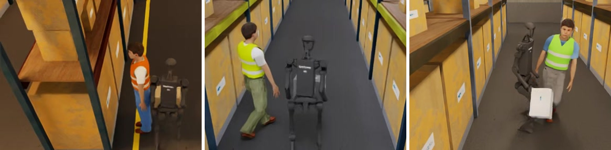

<div align="center">

# KETI Humanoid HRI Safety Dataset — Code and Specification

**The pipeline that generates, labels, converts and validates the dataset, and the specification it follows**

[](README.md)
[](README.ko.md)

[](https://huggingface.co/datasets/KETI-IRRC/keti-humanoid-hri-safety)
[](docs/tech-report/humanoid-dataset-technical-report-v0.1.pdf)
[](LICENSE)
[](LICENSE-DATASET)



*`S1e` a corner hidden by a rack · `S1f` stepping in from the side · `S1g` turning round with a box*

</div>

## Overview

This repository holds the code and the specification behind the
[KETI Humanoid HRI Safety Dataset](https://huggingface.co/datasets/KETI-IRRC/keti-humanoid-hri-safety): the warehouse
scenes and scenarios for NVIDIA Isaac Sim and Isaac Lab, the recorder and the labeller, the converter to LeRobotDataset
v3.0, the validator, and the documents they follow. The data itself is on the Hugging Face Hub.

The dataset records **failures, near-misses and boundary cases**: a Unitree H1 carrying a box meets a person in places
where it does not see them in time, and the recorded robot does not react to the person. Labels are **computed, not
annotated** — the decision rules compare the contact force on twelve body regions with the limits of ISO/TS 15066
Annex A, and the distance to the person with the robot's protective separation distance. Every label names the rule
that produced it and the clause that rule rests on.

| | |
|---|---|
| Dataset | [`KETI-IRRC/keti-humanoid-hri-safety`](https://huggingface.co/datasets/KETI-IRRC/keti-humanoid-hri-safety) — release `26.11`, tag `v26.11.1` |
| Episodes | **297** in three scenarios (`S1e` · `S1f` · `S1g`), seven cameras |
| Robot | Unitree H1 (19 DOF) |
| Simulator | NVIDIA Isaac Sim · Isaac Lab — versions pinned in [`environment.lock`](environment.lock) |
| Format | LeRobotDataset v3.0 + `safety.*` extension (schema `0.2`) |
| Standards | ISO/IEC Guide 51 · ISO 12100 · ISO 10218-1 · ISO/TS 15066 · ISO/CD 25785-1 · ISO/IEC TS 22440-1 |
| Code tags | Every `v26.11.*` tag of this repository holds the code that generated release 26.11; the later tags change documents and the assembly and publishing code |

## Quick start

```bash
make venv     # once after cloning: creates .venv and installs requirements.txt
make check    # the validator's own regression tests and the unit tests
```

`make` uses `.venv` without activating it. Download the release with the Hub's `hf` command (it comes with
`huggingface_hub`, which `requirements.txt` does not install):

```bash
hf download KETI-IRRC/keti-humanoid-hri-safety --repo-type dataset \
    --revision v26.11.1 --local-dir <release>
```

Then, with nothing but this repository — no Isaac Sim, no network:

```bash
# checks C1–C8 (C9 needs Isaac Sim)
.venv/bin/python validator/validate_dataset.py <release>
# rebuild every label from the release
.venv/bin/python generation/labeling/check_release_labels.py --dataset <release>
# the scorecard, per scenario
.venv/bin/python generation/scorecard.py --dataset <release>
# a copy lerobot-train accepts
.venv/bin/python scripts/make_train_copy.py <release> <new_dir>
```

What each check looks at and its exit codes are in [`validator/README.md`](validator/README.md). The training copy
leaves the release untouched and hard-links its videos; what it changes is in the tool's header and in the dataset
reference's "LeRobot's own tools". Opening the release with LeRobot is in the
[dataset reference](docs/dataset-reference.md); generating episodes again (Isaac Sim) is in
[`generation/README.md`](generation/README.md).

## What is here

| Path | Contents |
|---|---|
| [`docs/schema/`](docs/schema/) | Data schema — fields, joint layout, decision rules, validation rules, versioning |
| [`docs/scenarios/`](docs/scenarios/) | Scenario catalogue — scenarios, randomisation, episode allocation |
| [`docs/assets/`](docs/assets/) | Asset licence inventory and redistribution policy |
| [`docs/sop/`](docs/sop/) | Data lifecycle procedure — pass criteria and prohibitions per stage |
| [`docs/tech-report/`](docs/tech-report/) | Technical report (Korean, CC BY 4.0) — composition, labelling, validation and use of the dataset; the PDF is the edition to read |
| [`docs/dataset-card.md`](docs/dataset-card.md) · [`docs/dataset-card.ko.md`](docs/dataset-card.ko.md) | Source of the dataset card — they become the release's `README.md` and `README.ko.md`. Their links are written for the release, so they open on the [Hub page](https://huggingface.co/datasets/KETI-IRRC/keti-humanoid-hri-safety) |
| [`docs/dataset-reference.md`](docs/dataset-reference.md) · [`docs/dataset-reference.ko.md`](docs/dataset-reference.ko.md) | Dataset reference (English · Korean) — every column, the condition tables, how each label is computed, scorecard and failure maps, limitations. Shipped in the release at the same paths |
| [`meta/`](meta/) | Canon — schema, decision rules and thresholds, scenarios, assets, cameras, joint names and order |
| [`validator/`](validator/) | Dataset validator C1–C9 and synthetic fixtures. Runs without Isaac Sim |
| [`generation/`](generation/) | Isaac Sim pipeline — generation, labelling, conversion, assembly, publishing |
| [`tests/`](tests/) | Regression tests |

Documents are written in Markdown. Standard values live in one place, `meta/rules.json`, and the documents point to it.

## Before you use it

- **Simulation only.** No sim-to-real validation has been performed.
- **One controller.** Every episode comes from one published walking policy that does not react to the person.
- **The person is a dummy.** It walks by a gait table while a hold carries part of its weight, and becomes a passive body at the first contact.
- **The forces are this dummy's, in this physics engine.** They are not measurements on a human body.
- **Labels cover only the rules the release's scenarios declare.**

The full list is in the [dataset reference](docs/dataset-reference.md).

## License

- Code: Apache-2.0 ([`LICENSE`](LICENSE))
- Documents: CC BY 4.0
- Dataset: CC BY 4.0 ([`LICENSE-DATASET`](LICENSE-DATASET) — in the release this file is `LICENSE`, and the code licence is `LICENSE-CODE`)
- Included assets: [`NOTICE`](NOTICE) — each asset keeps its own licence; the findings are in [`docs/assets/`](docs/assets/)

The release carries simulation output and the assets its episodes use: assets made for this project (with the CC0
textures they use as materials, a gait table derived from 100STYLE (CC BY 4.0), and KETI's own logo on the box
labels — the logo is marked apart from the dataset licence, may be redistributed only as part of the dataset, and no
trademark use is granted), and the Unitree H1 robot, a BSD-3 original, shipped unchanged under `assets/unitree_h1/`
with its copyright notice and licence text. Other third-party assets are not shipped; they are referenced by path,
version and SHA-256.

## Citation

```bibtex
@misc{keti_humanoid_hri_safety_dataset,
  title  = {KETI Humanoid HRI Safety Dataset},
  author = {Korea Electronics Technology Institute},
  year   = {2026},
  note   = {Version 26.11.1. LeRobotDataset v3.0 with safety extensions},
  howpublished = {Hugging Face Hub}
}
```

## Project and contact

Built by the **Korea Electronics Technology Institute (KETI)** as part of the project "Establishment of Evaluation
Infrastructure for AI Humanoid Safety and Security" (산업혁신기반구축사업, 2026).

Questions and bug reports are taken as issues on this repository. This repository is published as one commit per
release, so pull requests are not merged here — read [`CONTRIBUTING.md`](CONTRIBUTING.md) before changing the code.
